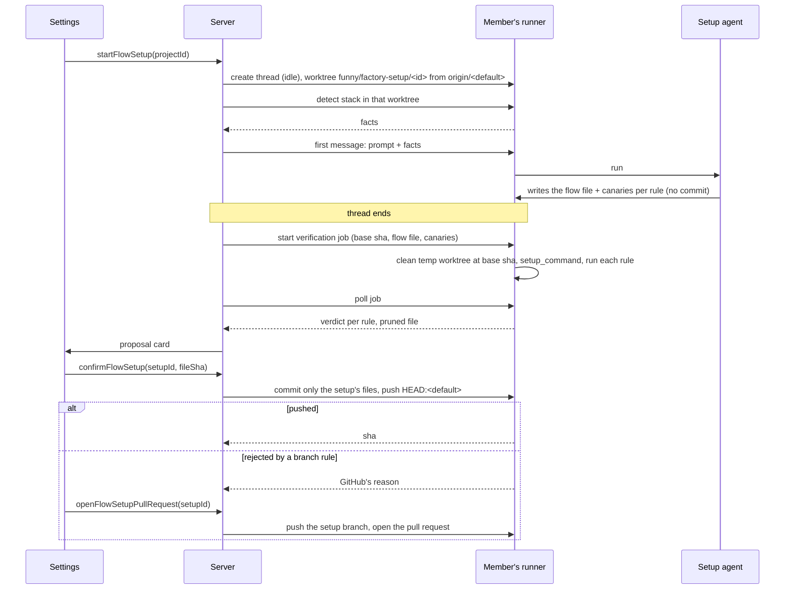

# Design

## Context

See proposal.md for the motivation and specs/ for the behavior.

- The factory loads its flow with `loadFactoryFlow(name, flowReadsOf(github, reader))`
  (`server/services/factory/factory-flow.ts`) over the App contents API, at the default branch's
  head commit, which the run records. It fails as `invalid` (every run would fail the same way) or
  `unavailable` (GitHub cannot be read now).
- `validateFlow` (`factory-queue-flows.ts`, tRPC + client hook) already loads a factory's flow
  exactly as a run would and summarizes it.
- Admission checks proof-readiness per pass (`flowProofReady` in `factory-watcher-admission.ts`). A
  flow that fails to load is NOT held back there: its run reports why. It writes
  `factory_settings.blocked_reason` and the run's `wait_reason: proof-not-configured`.
- Saving settings (`createFactorySettingsService`) never loads the flow.
- The runner's proof service (`runtime/services/regression-proof.ts`) has `matchesGlob`,
  `fillCommand`, `inconclusiveBaseFailure`, temporary worktrees at a commit prepared by
  `setup_command`, and long runs as polled jobs (`startProofJob` / `getProofJob`).
- The runner writes a thread's `roleInputs` only for a read-only thread
  (`thread-service/create.ts`).
- Default sensitive paths (`factory-risk.ts`) are `.github/**`, migrations and `auth/**`. A
  factory's settings can only add to them. `.funny/**` is not one.
- A factory has a mode (`automatic` / `manual`) and one configured flow (`flow_name`); a send may
  name another flow.

## Goals / Non-Goals

**Goals:**

- A factory cannot be turned on into a state where no run of its flow could merge.
- The generated rules are checked by running them, by funny, in a checkout the agent did not touch,
  before anyone is asked to commit them.
- No model output decides whether a rule is accepted, and no agent commits or pushes.
- A protected default branch does not dead-end the setup.

**Non-Goals:**

- Reading the flow from a runner's checkout, or from the factory's "Merge into" branch (D2).
- Generating anything but `regression_proof` in the flow file.
- Fixing a flow file that does not parse, or re-generating rules of a flow that is proof-ready:
  both stay a human job.
- Detecting stacks other than JavaScript / TypeScript in v1. For another stack the detector reports
  what it found (files, no runner) and the agent proposes rules; the verifier still decides.
- A sandbox runtime for the setup thread in v1 (the member's local runner only).

## Decisions

### D1. The readiness check is `validateFlow`; the enable gate uses it

No second loader. `FactoryFlowValidation` gains `proofReady` (when it lacks it), and the settings
service asks the queue's `validateFlow(factory, flow_name)` when a save turns the factory on
(`enabled: true` on a row that is off or does not exist):

| Validation                     | Save                                                           |
| ------------------------------ | -------------------------------------------------------------- |
| ok, proof-ready                | saved, enabled                                                 |
| ok, not proof-ready            | `failure(409, 'flow-not-ready')`, kind `proof-not-configured`  |
| not ok (`invalid`)             | `failure(409, 'flow-not-ready')`, kind `invalid`, the problems |
| err (`unavailable`, no App, …) | `failure(503, 'flow-not-checked')` with GitHub's message       |

Saving other fields of an enabled factory does not check. The gate checks the factory's configured
flow in both modes: a member who only wants pull requests sets `issue-to-pr`, which has no `merge`
step and is ready. A send that names another, not proof-ready flow keeps today's admission blocker.

Admission is unchanged (a flow that cannot load still fails in its run), so its tests do not move.

_Alternative:_ a new `flowReadiness` shared with admission. Rejected: it duplicates `validateFlow`
and would change what admission does with a load error.

### D2. The flow is still read from GitHub's default branch

Considered and rejected for this change:

- **Reading the runner's checkout.** The flow is the factory's merge policy. A local-mode thread
  works in that directory, so any agent (or an injection in an issue) could edit it with no commit,
  author or review. Its content would depend on the branch checked out and on uncommitted changes,
  so a run could not record what it ran. Runs start from `origin/<base>`, sandbox runs have no
  access to the disk, and the server could not evaluate the factory with the runner offline.
- **Reading "Merge into".** Useful for repositories that integrate on `develop`, but it changes the
  policy source of every factory with that setting (one existing factory names a run's branch
  there). It is a separate change.

So the setup's target is always the repository's default branch, and the push is the one outward
write of the feature.

### D3. `.funny/**` and `.funny.json` are default sensitive paths

Added to `DEFAULT_SENSITIVE_PATHS`; the reason shown is the existing "touches a sensitive path".
Settings only add to that list, so no factory can remove them. `.funny.json` is included because
its `postCreate` runs in every proof checkout. Independent of the rest; ships first.

### D4. The setup: a thread between deterministic steps



- **Thread.** A normal worktree thread on the member's runner (`startThreadOnRunner` with
  `withRunnerFor(member, project)`, role `factory-setup`, intent `idle`), on the branch
  `funny/factory-setup/<id>` from `origin/<default>` after a fetch. Not read-only: the agent runs
  the repository's test commands to find what works. It gets what a factory run's implementer gets
  and nothing more. Every server → runner step goes through the certified sink; nothing new on the
  runner → server data channel.
- **Facts.** `detectTestStack(checkout)` in `@funny/core`, no model: package manager by lockfile,
  workspaces (pnpm / npm / yarn / bun) and Nx projects with a `test` target, test runner per package
  (jest, vitest, bun test, from config files and `package.json`), test file patterns found, and
  test files that look like they need infrastructure (`*.integration.*`, `*.e2e.*`, testcontainers,
  database clients). The server asks for them once the worktree exists and sends them inside the
  first message, in a fenced block: they are funny's own output, not issue text, and `roleInputs`
  is a read-only-thread mechanism.
- **The setup's files.** The flow file, plus, when the flow starts from the built-in one, the
  built-in prompt files it names with `prompt_file`: a repository flow reads its prompt files from
  the repository, so a copy without them does not load. The server writes those prompt files; the
  agent does not edit them. The proposal shows them and they are committed with the flow.
- **Agent output.** The flow file: the repository's own `.funny/workflows/<flow>.yaml` when it
  exists (the setup is offered only when it parses), else the built-in flow, with only
  `regression_proof` (`rules`, `setup_command`, `support_globs`) changed. Per rule, a passing and a
  failing canary matching the rule's globs, placed where that package's runner picks tests up. It
  lists what it left out and why. It does not commit.
- **Verification (runner job, no model).** The server refuses a flow file that differs from its
  starting file outside `regression_proof`, parses it with the flow parser and checks
  `isProofReady`. Then the runner, in a temporary worktree at the setup's base commit (never the
  agent's worktree, whose other edits are discarded), copies in only the canaries, runs
  `setup_command`, and for each rule:
  1. the passing canary through `fillCommand` exits 0 and the output names it;
  2. the failing canary exits non-zero, the output names it, and `inconclusiveBaseFailure` is null;
  3. an existing test file of the repository that the rule matches, not flagged as needing
     infrastructure, exits 0 (up to three candidates are tried). A rule that matches no such file
     is rejected: nothing shows it can load real tests;
  4. passing two files at once (the passing canary and that existing test file) through
     `fillCommand` exits 0 and the output names both: this catches commands whose flag only takes
     one argument (such as `ng test --include {{files}}`) or silently drops extra files.

  Rejected rules are removed from the file and listed with their output. No rule left: the setup
  fails with the outputs. The job has its own time budget (30 minutes: a cold install plus the
  runs), and is polled like a proof job.

- **Setup row and its state machine.** `factory_flow_setups` (project, user, flow, base sha, thread
  id, file and its sha, facts, per-rule verdicts, push or pull request result, state). One
  transition table, compare-and-set writes:

  ```mermaid
  stateDiagram-v2
    [*] --> generating
    generating --> verifying: thread ended
    generating --> failed: thread stopped, failed or deleted
    verifying --> proposed: a rule accepted
    verifying --> failed: no rule, invalid file, job lost or timed out
    proposed --> committing: member confirms
    committing --> committed: pushed
    committing --> push_rejected: branch rule
    committing --> proposed: runner unreachable, file not on the branch
    push_rejected --> pr_open: member opens the pull request
    proposed --> discarded
    push_rejected --> discarded
    pr_open --> committed: file is on the default branch
    pr_open --> discarded: pull request closed
  ```

  On server start and on a timer, a `verifying` setup whose job the runner no longer has becomes
  `failed`, and a `committing` one is settled by reading the default branch (file there with the
  setup's sha: `committed`; otherwise back to `proposed`). `pr_open` settles when readiness is read.
  One setup that is not ended per member, project and flow.

- **Confirm.** `confirmFlowSetup(setupId, fileSha)`: only the setup's own user, with `steer`. The
  runner commits ONLY the setup's files on the setup branch (the shown bytes, checked by sha) and pushes
  `HEAD:refs/heads/<default>` without force; when the remote moved it rebases that one commit once.
  The push uses the member's own git credentials, as their commits do. A rejection by a branch rule
  ends in `push_rejected` with GitHub's message.
- **Pull request fallback.** From `push_rejected`, the member can have funny push the setup branch
  and open a pull request to the default branch with the member's token (title, the proposal's
  summary as body). Funny does not merge it; the factory stays off until the file is on the default
  branch.
- **Opt-out.** The card also offers "Merge without regression proof": the starting flow file with
  `require_regression_proof: false`, through the same confirm path, so the choice is a visible
  commit. It is offered on a failed setup too.
- **Cleanup.** On `committed` and `discarded` the setup's worktree and branch are removed through
  `workspace-cleanup.ts` (`cleanupWorkspace`); on `pr_open` the worktree only. Each outward write
  (push, pull request) is recorded as a background activity.

_Alternative:_ let the agent commit and push. Rejected: the push is an outward write the member
confirms, and the agent's work is the input to a check, not the check.

_Alternative:_ a fixed template per stack and no model. Kept as the facts layer; on its own it
fails on real monorepos (per-project runner configs, infrastructure specs).

_Alternative:_ always open a pull request. Rejected: the member asked for a direct commit, and an
unprotected branch needs no review round. The pull request is the fallback.

### D5. The client

The factory settings read the flow's validation (existing query, invalidated on save and on setup
events). The enable switch is disabled with the reason while not ready. "Generate configuration"
shows whenever the configured flow validates but is not proof-ready, for a factory that is off or
on (an enabled, blocked factory such as goliiive's gets it too). The setup's thread opens like any
thread. The proposal card shows the file diff, the facts, each rule's three runs with output, what
is uncovered, and "Commit and push to `<default>`", "Merge without regression proof", "Discard";
after a rejected push, GitHub's reason and "Open a pull request"; then the pull request's link.
Every interactive element gets a `data-testid`; the rows are indexed in `settings-index.ts`.

## Risks / Trade-offs

- [Canaries are written by the model] → They show only that the command runs the matched file and
  reports an assertion as such; check 3 shows it loads the repository's real tests; the per-issue
  proof still runs base against head.
- [The setup runs repository code on the member's runner] → The same code a factory run runs there;
  worktrees only, bounded time, no extra secrets.
- [A copied built-in flow stops following funny's later versions] → Existing convention (the
  built-in file says "copy this file"). The proposal names the built-in version it started from.
- [`.funny/**` sensitive makes a run's legitimate flow edit high risk] → Intended.
- [The verification passes locally and a sandbox run differs] → v1 verifies where the member's
  factory runs run today (their runner). Listed for the sandbox follow-up.
- [The enable gate needs GitHub] → `flow-not-checked` is its own answer, and says so.

## Migration Plan

1. D3 (sensitive paths): no factory changes state.
2. D1 (enable gate, `proofReady` in the validation): only new enables are refused.
3. D4 + D5 (setup).

Rollback: each step is independent; the setup table is additive.

## Open Questions

- Whether to also offer the setup from the queue's blocked banner: UI placement, no spec change.
