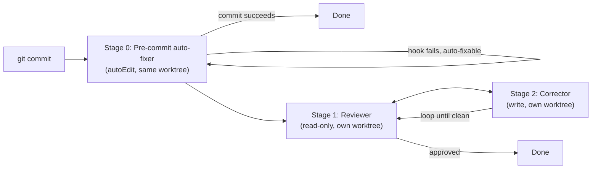

# Pipelines, review/fix stages, and automation

funny has two distinct "multi-step automation" systems that are easy to confuse. This page separates them.

## 1. The post-commit review/fix pipeline (in-app)

Documented in [`docs/architecture/pipeline.md`](../../docs/architecture/pipeline.md): an automated code review and fix loop that runs after every git commit inside a thread, using AI agents to review changes and iteratively fix issues.

**Key design principle:** every stage runs in its **own git worktree**, so multiple agents (and their review/fix stages) never collide on a checkout. Without this, a reviewer/corrector stage running against a parallel agent's shared working directory could apply a patch while that agent is still writing to it. Each stage thread is visible in the sidebar with its own status, and the parent thread keeps working while the pipeline runs in the background.

This pipeline is implemented via `packages/runtime/src/services/pipeline-manager.ts` and `packages/runtime/src/pipelines/yaml-loader.ts`. The pipelines use the generic `@funny/pipelines` engine (graph execution, JSONata expressions, Mustache templating) and define domain concepts (agents, git, commands) through the `ActionProvider` interface: the YAML compiler, the provider contract and approval gates live in `packages/workflows/src/compiler/` (`yaml-compiler.ts`, `action-provider.ts`, `approval.ts`), and `packages/runtime` supplies the agent/git/command actions.

## The engine: graphs, loops, joins, groups and the journal

`@funny/pipelines` runs every pipeline as a graph on a ready-queue scheduler (`packages/pipelines/src/scheduler.ts`, rules in `graph.ts`). Its public API is Promise-based (`runPipeline`); Effect is used inside for interruptible nodes, retry backoff and waits.

- **Graph.** A node starts as soon as its dependencies have finished, up to `maxConcurrency` at a time, so a slow branch never holds an unrelated one. In code, a pipeline where no node declares `dependsOn` is a chain in declaration order. In YAML, `depends_on` defaults to `[]`, so a node without it is a root and runs in parallel with the other roots: write `depends_on` to order steps. A node reads its dependencies' result (merged in declaration order when it has several), never "whatever finished last".
- **Joins** (`trigger_rule`). `all_success` (default): no dependency failed. `all_done`: every dependency finished, whatever the result. `one_success`: as soon as one succeeded. A node whose rule can no longer be met is skipped, and that skip propagates to `all_success` dependents; a node skipped by its `when` guard counts as done.
- **Failure.** `on_error: fail` (default) stops new nodes, aborts the nodes still running in other branches and waits for them (`stopGraceMs`) before reporting the first failure; cancelling a run does the same and returns `outcome: 'cancelled'`. `on_error: continue` marks the node failed and lets the joins decide, so a dependent on the default join (`all_success`) is skipped; before the graph engine the failure was swallowed and dependents ran. Give the dependent `trigger_rule: all_done` to keep that behavior. The parser warns about a dependent of a `continue` node that declares no `trigger_rule` (`packages/workflows/src/warnings.ts`); a warning blocks nothing: the editor shows it, the workflow API returns it as a diagnostic with `severity: 'warning'`, and the runtime and factory log it on load. Nodes must honor their `AbortSignal`: interrupting a wait cannot stop an arbitrary Promise.
- **Loops.** `loop` may sit on several nodes. A loop on X repeats its region, every node on a path from `loop.back_to` (X itself by default) to X, until `until` holds after X succeeds; after `max_iterations` visits X fails with "loop exhausted". Regions must be nested or disjoint, and a node outside a region that depends on it waits for the loop to exit. Each execution is identified by its visit path (`"2.1"`: second visit of the outer loop, first of the inner one).
- **Concurrency groups** (`concurrency: { group, limit }`). The node waits for a slot of the group, across every run of the host, after its `when` passes, reported as the node state `waiting_slot`, and holds it until its work has stopped (retries included). The group may use `{{inputs.*}}` only (e.g. `merge-{{inputs.repo}}`, one merge at a time per repository). A limit-1 group may batch: the first waiter leads and settles up to `max - 1` members, whose nodes do not run (`packages/pipelines/src/gate.ts`). Runtime, orchestrator, harness and scheduler share the in-memory FIFO gate of the process (`defaultConcurrencyGate`).
- **Journal and resume.** With a `Journal`, every node execution is recorded (`packages/pipelines/src/journal.ts`, `replay.ts`). A run that starts again skips executions recorded as succeeded (using their recorded output, so `when` / `until` follow the same path) and re-runs an unfinished one with `resume.recorded`, so the action can adopt the work it started. Only the server keeps a journal; the other hosts run without one and do not resume after a restart.
- **Hosts can add rules** through the parser's `validate` hook: the issue factory refuses two agent steps in parallel branches, because its run has one agent thread (`packages/server/src/services/factory/factory-flow.ts`).

On the server (the issue factory), the journal lives in `workflow_node_executions` (`packages/server/src/services/workflow-engine/journal-repository.ts`), and concurrency groups are leases shared by every server instance (`lease-gate.ts`, `lease-store.ts`): a lease is renewed every 30 s and expires after 2 min without renewal, and batch members are stored with their leader's lease. The execution and lease state machines are in [`docs/architecture/state-machines.md`](../../docs/architecture/state-machines.md).

The workflows canvas (`packages/client/src/components/WorkflowsSettings.tsx`, nodes in `components/workflows/WorkflowNodeView.tsx`) draws loop regions, non-default joins, concurrency groups and the `waiting_slot` state.

Related runtime services: `git-pipelines.ts`, `pipeline-adapter.ts`, `git-workflow-service.ts`, `pipeline-dispatcher.ts` (runs a workflow started from `/api/workflows`), `pipeline-dispatcher-adapters.ts`, `pipeline-approval-store.ts`, `pipeline-prompts.ts`.

**This is distinct from `packages/reviewbot`.** `reviewbot` is a standalone webhook service that reviews already-opened GitHub PRs via the Anthropic API and posts a `gh pr review` — it is not referenced anywhere in `docs/architecture/pipeline.md` and nothing in the runtime pipeline imports it. See [integrations/extensions-and-services.md](../integrations/extensions-and-services.md).

## 2. Workflows and scheduled automation

- **`packages/workflows` (`@funny/workflows`)** defines YAML-based workflow catalogs (graph builder + Zod schema + serialize/parse). Its `@funny/workflows/compiler` subpath compiles a workflow into a `@funny/pipelines` definition against an `ActionProvider`; consumed by `packages/runtime/src/pipelines/yaml-loader.ts`, surfaced in the UI at `packages/client/src/components/WorkflowsSettings.tsx`, and used by `packages/scheduler/src/dispatcher.ts`.
- **Automations** (user-defined prompt + cron schedule, `automations` / `automation_runs` tables) are run by the **server**, not the runner:
  - `packages/server/src/services/automation-scheduler.ts` keeps one croner job per enabled automation. The automation routes reschedule on create/update/delete. There is no catch-up after downtime.
  - On each tick, or on `POST /api/automations/:id/trigger`, it starts a read-only `source: 'automation'` thread on the **owner's** runner via `startThreadOnRunner` (`services/runner-thread-launcher.ts`), which delegates to the `modules/threads` creation use case that interactive threads use. Runner isolation and the project ↔ runner binding therefore apply unchanged.
  - The run is recorded in `automation_runs`. If the owner's runner is unreachable, the run is recorded as failed and is not retried on another runner.
  - `services/automation-runs.ts` completes the run when the runner persists the thread's terminal status (`data-handler.ts` → `notifyTerminalStatusPersisted`), with no polling, and archives runs beyond `maxRunHistory`.
  - Every server process holds a timer per automation, and each scheduled occurrence is taken with a compare-and-set on `automations.next_run_at` before its run starts (`claimOccurrence` in `automation-repository.ts`, `occurrenceTaken` in `services/schedules.ts`), so several processes start one run per occurrence. A process that loses the claim starts nothing and records no skip. Manual runs take no occurrence.
  - Automations are **not** run by the issue factory's flow executor (ADR 0002, amendment): an automation is one read-only thread and needs no GitHub repository; the executor belongs to a factory. They share only how a schedule is fired.

## Optional durable-workflow infra (not part of the above)

`docker/docker-compose.hatchet.yml` spins up a self-hosted Hatchet stack (Postgres, RabbitMQ, hatchet-engine, hatchet-dashboard on `:8080`). No package uses Hatchet today — not `packages/scheduler`, `packages/workflows`, or the in-app pipeline above. Don't assume Hatchet needs to be running for normal thread automation.
